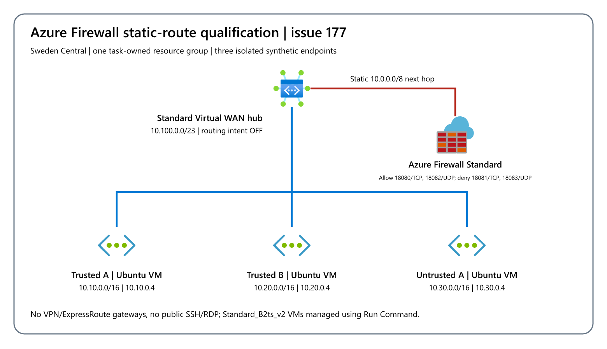
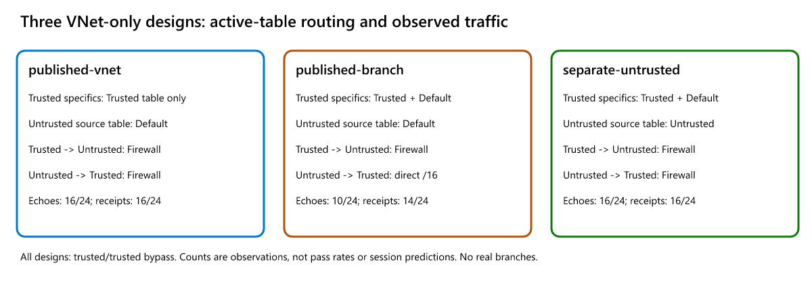

# Azure Virtual WAN: static Firewall inspection and selective bypass

**Three VNet-only designs were measured in Azure on 2026-11-16.** Explicit
ID-only propagation exposed a simulator bug, fixed in
[erjosito/vwan-visual-topology#192](https://github.com/erjosito/vwan-visual-topology/pull/192).
Sharing Default also produced asymmetric real traffic. A separate untrusted
association table restored the tested bidirectional behavior.

This is bounded routing evidence, **not an Azure certification, session model,
hybrid qualification or production recommendation**. Per-flow Firewall log
correlation remains an instrumentation gap, described below. The parent
[qualification issue](https://github.com/erjosito/vwan-visual-topology/issues/177)
must retain that limitation.

## Scope and topology



Sweden Central; one Standard Virtual WAN/hub (`10.100.0.0/23`); Azure Firewall
Standard, routing intent off; unchanged allow/deny policy; three Ubuntu 22.04
Gen2 `Standard_B2ts_v2` VMs with 30-GB Standard SSDs. VM management used Run
Command, not public SSH/RDP. No VPN/ExpressRoute gateway, Megaport, real branch,
customer input or pre-existing resource change was involved.

| Endpoint | VNet | Guest |
| --- | --- | --- |
| Trusted A | `10.10.0.0/16` | `10.10.0.4` |
| Trusted B | `10.20.0.0/16` | `10.20.0.4` |
| Untrusted A | `10.30.0.0/16` | `10.30.0.4` |

The original Firewall next hop was `10.100.0.132`. Every configured inspection
table had `10.0.0.0/8 -> original Firewall resource ID`. The Firewall policy
allowed TCP 18080/UDP 18082 and explicitly denied TCP 18081/UDP 18083 within
synthetic `10/8`. Every guest had echo services on **all four ports**, checked
locally before its remote probes.

## Independent observations



Trusted sources associate with Trusted in all designs. Untrusted propagates
None; connection propagation uses explicit table IDs with `labels: []`.

| Design | Trusted /16 propagation | Untrusted association | Echoes | Destination receipts |
| --- | --- | --- | --- | --- |
| `published-vnet` | Trusted only | Default | 16/24 | 16/24 |
| `published-branch` | Trusted and Default | Default | 10/24 | 14/24 |
| `separate-untrusted` | Trusted and Default | Untrusted | 16/24 | 16/24 |

Each original run contained six directions times four TCP/UDP ports, unique
nonces/source ports, timestamps and independent destination receipts. Counts
are observations, **not pass rates**. The second fixture's name denotes its
table pattern: the live endpoints were still VNets, not hybrid branches.

A separately named `published-vnet-confirmation` replay after the diagnostic
reset repeated all 24 first-design probes at 20:22 UTC: **16 echoes and 16
destination receipts**, with the same active-table results. It did not overwrite
the original observations or predictions. Total measured remote probes: **96**.

- **First design:** trusted/trusted echoed even on explicitly denied ports:
  positive bypass evidence. Cross-domain allow ports echoed; denied ports did
  not. Default's active Azure RIB contained only the Firewall aggregate.
- **Shared Default:** trusted /16s appeared in Default. Untrusted-origin UDP
  reached trusted guests directly on both allow **and deny** ports, preserving
  original tuples, but its echoes failed. Trusted-origin allowed UDP echoed;
  allowed cross-domain TCP did not. Failed echoes therefore do not establish
  forward-path isolation or prove an application route is absent.
- **Separate Untrusted:** its active RIB contained only the Firewall aggregate.
  Cross-domain allow TCP/UDP worked in both directions and denied ports failed;
  trusted/trusted continued to bypass.

`comparison.json` retains every probe, guest receipt correlation, selected
active table/next-hop type and any matching Firewall events. Its analyzer
asserts the actual connection association and longest-prefix Azure RIB
selection for every measured direction against the preregistered predicates.

## Simulator disagreement and fix

Baseline app source: `fa0ba11d1d4341cdda2d5abedf78d7a7f5571ab5`.
Fixed code source: `50be3b096f6afca717a5e1488196f7de9f2e2c5d`.
Engine version: `2026.11.16.13` (not incremented for this experiment).

Before any Azure traffic, `predictions-before-azure.json` preserved 18 direction
predictions and 36 native/mixed provider assessments: 28 satisfied and **eight
violated**, all in the ID-only first design. Its immutable original SHA256 is
`312b3ad06ad1ac1cbbf3c1c372336b06f3f29c3c0fef0abd8db6497b9846e2e5`.
The original is retained, not replaced by the fixed replay.

The old helper invented the Default label whenever labels were empty, even
when explicit propagation IDs selected only Trusted. The fix returns no labels
for explicit ID-only targets; a truly empty IDs-and-labels configuration retains
the legacy Default fallback. `predictions-after-fix.json` records **36 satisfied
routing predicates**, consistent with the tested active-table RIB selections.
This is not a semantic-fidelity percentage or a session-delivery guarantee.

Both new provider regression cases failed before the fix. Validation passed:
70 targeted units; all **879 full-suite units** with `--maxWorkers=1`; build;
lint (one unchanged existing warning); and all **four affected browser
workflows**, including worker/import parity for native and mixed topology.
Default-concurrency testing encountered an unchanged heavy diagnostics timeout
during concurrent lab work; baseline and isolated fixed-source checks passed.
No timeout, assertion or production budget was relaxed.

[Fresh app CI](https://github.com/erjosito/vwan-visual-topology/actions/runs/43948115969)
passed both `validate` and `desktop` on PR source
`a3256cfe8da787970b16603fcc6702c964bdf584`, including the full browser suite,
collector tests, production-artifact smoke and packaged offline/desktop-network
checks. The PR was merged into `main` on 2026-11-16 as
`9c23238b10d8b2775dd5fa88ff0fa880ab3bcf8a`.
[Post-merge validation and deployment](https://github.com/erjosito/vwan-visual-topology/actions/runs/43957623713)
are tracked separately from the original experiment. No new desktop release was
created, and this merge does not close the Firewall-log qualification gap.

## Instrumentation limits and retained disagreements

**Firewall per-flow logs are not established by this report.** Initial
diagnostics enabled legacy `AzureFirewallNetworkRule` with Dedicated destination.
The actual structured `AZFWNetworkRule` category was added at approximately
19:52 UTC. Both categories and the owned workspace destination were verified;
workspace health, public ingestion/query access, quota state and the query
clock were checked. Schema-tolerant legacy, structured and unfiltered queries
still returned no rows. The task-only diagnostic setting was reset and
restored; no routing or Firewall policy was changed to obtain a preferred
result. Missing logs are **never** counted as bypass evidence.

An independent `NetworkRuleHit` metric query over **19:20-20:17 UTC** recorded
**639 aggregate hits**. It supports active Firewall processing, but has no
per-probe five-tuple and cannot replace log correlation. See the retained metric
response, empty query results and diagnostic-setting outputs.

Additional boundaries:

- Concurrent effective-route requests for this one hub initially returned
  misleading identical snapshots. Authoritative evidence was recollected
  **sequentially**. This observation does not establish an Azure/CLI root cause.
- Unassociated spare tables returned empty effective RIBs despite configured
  statics. The simulator precomputes unused tables. Comparison is limited to
    **active source lookup tables and measured forwarding**.
- Azure rejected changing Default's internal lowercase `default` label; the
  scenario template was corrected before the measured runs.
- Equal-prefix static precedence, HRP, multi-hub, routing intent, arbitrary
  NVAs, ECMP and hybrid forwarding were not tested. No blanket "asymmetry means
  failure" rule was added; Firewall session state is outside the routing model.
- No authenticated portal screenshot is claimed. CLI/API, NIC/guest routes and
  independent guest observations are the evidence, not a diagram or screenshot.

## Reproducible inputs and collection

`infra/lab.bicep` is the final source with both diagnostic categories;
`infra/lab.initial.arm.json` preserves the initially deployed legacy-only
compiled template. `infra/scenario.bicep` contains the exact three ID-only
association/propagation configurations. Templates use Network API `2024-05-01`,
workspace API `2023-09-01`, diagnostics API `2021-05-01-preview`.
Azure CLI was `2.93.0`, virtual-wan extension `1.0.1`, azure-firewall `2.2.0`.
The runner lacked the required deployment handlers, so direct Bicep/ARM was
used without reading unrelated Megaport secrets.

Do not deploy into an existing resource group. Recheck both catalog restrictions
and live VM capacity, obtain cost approval, create a new correlation-tagged
group, and pin the authenticated subscription explicitly on every command.
Pass deployment parameters in a JSON file, not inline SSH-key arguments.
Example PowerShell shape, with operator-supplied values:

```powershell
az deployment group create --subscription $sub -g $newOwnedGroup `
  --name core --template-file infra\lab.bicep --parameters "@$parametersFile"
az deployment group create --subscription $sub -g $newOwnedGroup `
  --name scenario --template-file infra\scenario.bicep `
  --parameters "@$scenarioParametersFile"
# scenarioParametersFile selects published-vnet, published-branch or separate-untrusted.
# Wait for Succeeded and convergence, then collect each table sequentially:
az network vhub get-effective-routes --subscription $sub -g $newOwnedGroup `
  --name hub-fw177 --resource-type RouteTable --resource-id $tableResourceId -o json
az network nic show-effective-route-table --subscription $sub `
  -g $newOwnedGroup --name nic-trusted-a -o json
```

`scripts/guest-probe.py` accepts design, endpoint and
`prepare|probe|receipts`; upload through Run Command and retain JSONL output.
Run all endpoints' local controls/probes, then separately collect all destination
receipts. Queries should select the structured category and original probe
tuples/timestamps; do not conclude bypass from absent records.

The app's synthetic configurations are in `fixtures/`. To reproduce predictions,
clone `erjosito/vwan-visual-topology` beside this repo, check out the stated
baseline or fix, run `npm ci`, bundle `scripts/predict.ts` with that checkout's
esbuild, and set `PREDICTION_SOURCE` to the actual commit:

```powershell
& '..\vwan-visual-topology\node_modules\.bin\esbuild.cmd' scripts\predict.ts `
  --bundle --platform=node --format=esm --outfile=scripts\predict.mjs
$env:PREDICTION_SOURCE = git -C '..\vwan-visual-topology' rev-parse HEAD
node scripts\predict.mjs predictions-replay.json
```

Use a **new output filename**, preserving original evidence.
`python scripts\analyze.py` reruns the published evidence checks.

## Cleanup and cost

Only the previously absent, ownership-tagged task resource group and its
task-created resources are eligible for deletion. The preview contained the
WAN/hub, Firewall/policy, workspace, NSG, three VNet/NIC/VM/disk sets and
subscription-policy-installed MDE extensions. No pre-existing resources were
included. **Cleanup was verified at 20:58:21 UTC on 2026-11-16**: the task
resource group is absent and no correlation-tagged orphan resources remain.
See [absence verification](cleanup-result.json) and the
[empty orphan check](raw-output/cleanup-orphan-check.json). Deletion was
submitted at 20:25 UTC; its long-running Firewall/hub lifecycle was allowed to
finish before claiming success. No pre-existing resources were deleted.

User approval included charges and task-owned cleanup. Under US$25 was a target,
not a hard cap or an actual bill. Public Sweden Central Firewall retail meters
included US$1.25/hour secured-hub deployment and US$0.016/GB processed; additional
capacity and other-resource meters apply. Billing is delayed; no complete
actual-cost figure is claimed.

## Evidence handling and references

Public output is an explicit allowlist, not a dump of the lab directory.
GUIDs, email/public-IP strings and identity/OS-profile metadata were removed or
redacted. Ownership markers, SSH parameters, credentials, activity logs,
local profile paths and bundled app/dependency code are excluded.
`export-manifest.json` documents the exported files and policy.

Diagrams include editable SVG, Mermaid and draw.io sources. Official Microsoft
Azure icons retain their native proportions inside uniform 64px footprints;
Microsoft trademarks remain Microsoft's. Sources:
[hub](https://app.diagrams.net/img/lib/azure2/networking/Virtual_WAN_Hub.svg),
[Firewall](https://app.diagrams.net/img/lib/mscae/Azure_Firewall.svg),
[VNet](https://icons.diagrams.net/assets/azure/1/Virtual_Network_vNET.svg).

Official references:
[selective bypass](https://learn.microsoft.com/azure/virtual-wan/firewall-custom-bypass),
[static routes](https://learn.microsoft.com/azure/virtual-wan/static-routes),
[Firewall monitoring](https://learn.microsoft.com/azure/firewall/monitor-firewall),
[diagnostic settings](https://learn.microsoft.com/azure/azure-monitor/data-collection/diagnostic-settings).
